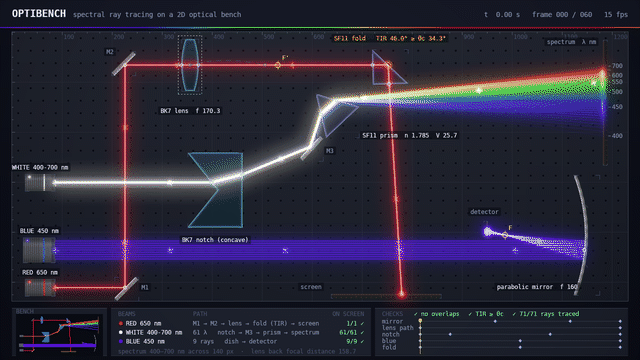
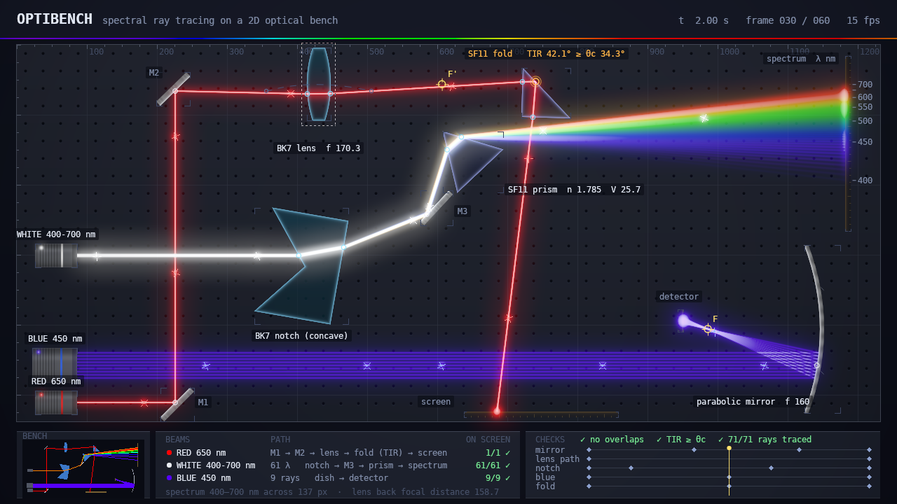

# OptiBench

[](https://github.com/KiseraTimon/OptiBench/actions/workflows/ci.yml)


> A 2D optical bench, ray traced and rendered from scratch: mirrors, lenses and prisms, real glass
> dispersion splitting white light into a spectrum, total internal reflection, and a parabolic mirror's
> focus. Every pixel is drawn by the project's own raster code.



**Status:** Final combined scene (phase 2 complete)

## Description
OptiBench simulates how light travels through an optical bench: laser rays reflect off mirrors,
bend through lenses and prisms, and split into colours. Phase 1 built the 2D raster foundation (lines,
polygons, clipping and filling, circles and ellipses, curves). Phase 2 built the bench on top of it
(scene architecture, transform and optics math, animation, raster operations and sprites, geometry),
and the final combined scene brings every module together.

### Highlights
- **Physically based light.** Snell's law and total internal reflection. Glass disperses light using
  catalogue data (Schott n<sub>d</sub> and Abbe numbers through Cauchy's equation), so a white beam fans into
  a spectrum whose wavelength scale is drawn where each colour actually lands.
- **Exact optics.** A thick spherical lens with a lensmaker focus, a parabolic mirror built as an exact
  quadratic Bézier, and concave prisms. A collimated beam meets at the dish focus to within 10<sup>-6</sup> px.
- **A renderer written from scratch.** HDR light buffer, Gaussian beam profiles, two-scale bloom, tone
  mapping, CIE 1931 spectral colour, linear-light blending, anti-aliased shading from signed distance
  fields, and anti-aliased text, all without external libraries.
- **Self-checking.** Each frame verifies that no elements overlap, that every total internal reflection is
  at or past the critical angle, and that every ray lands on a screen. The program exits non-zero
  otherwise. 33 ctest suites run on Linux (GCC, Clang, ASan/UBSan) and Windows (MSYS2) in CI.

## Group Members

- Sean Mudibo - Polygon Clipping
- Cyprian Kamau - Curves
- Sharon Njogorio - Lines
- Amy Mugeni - Polygons
- Kisera Timon - Circles & Ellipses

## Technologies / Tools
- VS Code or CLion IDE
- C++20
- CMake, g++ / clang / MSVC
- Git + GitHub
- Output: `.bmp`

## Prerequisites
This project requires MSYS2's GCC and cmake to run. A comprehensive guide has been provided **[here](references/prerequisites_guide.pdf)**

## Quick Start
```bash
git clone https://github.com/KiseraTimon/OptiBench.git && cd OptiBench
cmake --preset release            # or: cmake -S . -B build -DCMAKE_BUILD_TYPE=Release
cmake --build --preset release    # or: cmake --build build
ctest --preset release            # every test (or: ctest --test-dir build --output-on-failure)
./build/OptiBench                 # Windows: .\build\OptiBench.exe   (run from the repository root)
```

The application renders the final scene and checks it as it goes:

```
OptiBench 1.0.0: 61 frames (4 s at 15 fps)
  overlapping element pairs over all frames: 0
  total internal reflections: 61 (all at or past the critical angle: yes)
  rays traced: 4331, landing on a screen: 4331
  spectrum (400-700 nm) spread on the screen: at least 136 px
```

| Option | |
|---|---|
| `-o, --out DIR` | folder for the images (default `output`) |
| `--duration S`, `--fps N`, `--still T` | length, frame rate, and the time of the still frame |
| `--no-frames`, `--no-sheet` | skip the per-frame images or the contact sheet |
| `--no-bounds` | hide the broad-phase bounding boxes |
| `-q, --quiet`, `-h, --help`, `--version` | |

Presets: `release` (build/), `debug` (build-debug/) and `sanitize` (build-sanitize/: AddressSanitizer and
UBSan; GCC or Clang, not MinGW). Presets need CMake 3.21+; the plain commands work with 3.20.

### Live, interactive bench
`OptiBench_live` opens the same scene in a window, animating in real time, and lets you edit it with the
mouse. Every frame is re-traced, so the light follows immediately. The window is drawn with plain Xlib on Linux (WSLg
works) and Win32 GDI on Windows, so there are still no third-party libraries. See [docs/live.md](docs/live.md).

```bash
./build/OptiBench_live            # Windows: .\build\OptiBench_live.exe
```

| Input | |
|---|---|
| left-drag | move an element (refused, in red, if it would overlap another one) |
| wheel / right-drag | rotate the element under the pointer (Shift fine, Ctrl coarse) |
| `P` | edit the lens's Bezier motion path: drag control points, Ctrl+click adds one, right-click removes one |
| `Space`, `,` `.`, `-` `=` | play / pause, step one frame, slower / faster |
| `Del`, `Tab`, arrows, `Q` `E` | hand an element back to the animation, select next, nudge, rotate |
| `R`, `B`, `S`, `H`, `Esc` | reset, bounding boxes, screenshot to `output/live_###.bmp`, help, quit |

Where it runs (no WSL needed):

| Platform | Window | Notes |
|---|---|---|
| Windows (MSYS2 UCRT64, the team toolchain) | native Win32 | builds with the same `cmake` commands, nothing to install |
| Linux | X11 (also XWayland) | needs the X11 headers: `sudo apt install libx11-dev`; without them the target is skipped |
| WSL 2 on Windows 11 / recent Windows 10 | X11 through WSLg | as Linux |
| macOS | not supported | everything else still builds; `OptiBench_live` is skipped |

To make a video or a GIF of the frames, use
`ffmpeg -framerate 15 -i output/frames/final_%04d.bmp -pix_fmt yuv420p output/final_scene.mp4`
or, without ffmpeg, `python3 tools/make_gif.py` (needs Pillow).

## How to Compile and Run (module by module)
Requires a C++20 compiler and CMake 3.20+.

```bash
git clone https://github.com/KiseraTimon/OptiBench.git
```

```bash
cd OptiBench
```

```bash
cmake -S . -B build
```

```bash
cmake --build build
```

### Setup

```bash
.\build\ok_test.exe
```

Running the okay test should instantiate the Framebuffer to make a gradient image. If this is successful, the program works okay

### Running all tests
```bash
ctest --test-dir build --output-on-failure
```

Runs every module's test executable from the repository root.

### Polygon clipping & filling
```bash
.\build\test_clip_fill.exe  # test file
```

```bash
.\build\demo_clip_fill.exe  # demo file
```

The demo writes `output/clip_fill_demo.bmp`: a prism (scanline fill), a light beam clipped to the bench
viewport and to the prism (Sutherland-Hodgman), laser rays trimmed to the viewport (Cohen-Sutherland),
and a laser source and mirror coloured with flood/boundary fill. Run it from the repository root.

### Lines
```bash
.\build\test_line.exe  # test file
```

```bash
.\build\demo_line.exe  # demo file
```

The demo writes `output/line_demo.bmp`: Features three distinct optical paths—red, green, and
blue—bouncing jaggedly in a zig-zag pattern between parallel white boundaries (mirrors) before
hitting a yellow vertical line (detector) on the right

### Polygons
```bash
.\build\test_polygon.exe  # test file
```

```bash
.\build\demo_polygon.exe  # demo file
```

The demo writes `output/polygon_demo.bmp`: Presents a simple scene with a hollow cyan rectangle on
the left and a hollow yellow triangle on the right, mapped on a dark background grid with white dots
marking the vertices of both shapes

### Circles & Ellipses
```bash
.\build\test_circle_ellipse.exe  # test file
```

```bash
.\build\demo_circle_ellipse.exe  # demo file
```

The demo writes `output/circle_ellipse_demo.bmp`: Displays a large blue circular lens bordered
in cyan with a red laser ray approaching from the left, refracting inside the lens,
and exiting out the other side as a white/yellow line.
The scene also includes a yellow ellipse in the top right and a series of
concentric grey circles in the bottom left

### Curves
```bash
.\build\test_curves_bezier.exe  # test files: test_curves_*.exe (bezier, composite, splines, editor, optics, render, nurbs)
```

```bash
.\build\demo_curves.exe  # demo file
```

The demo writes `output/curves_demo.bmp`: four panels showing the anatomy of a cubic Bézier curve
(de Casteljau construction, tangent and normal, tight bounding box, adaptive flattening points), four
splines through the same points (Catmull-Rom uniform and centripetal, natural cubic, clamped B-spline),
parallel laser rays refracting through a lens whose faces are Bézier curves, and a parabolic mirror
focusing rays above a gradient-index fibre that guides rays along smooth curved paths. Design notes,
usage and references are in **[docs/curves.md](docs/curves.md)**.

### Transform & Optics Math
```bash
.\build\test_mat3.exe        # 3x3 homogeneous matrix toolkit
```

```bash
.\build\test_refraction.exe  # Snell's law + total internal reflection
```

`Mat3` (`include/optibench/Mat3.h`) builds translate, scale, shear, rotate (about the origin or a pivot),
reflect (across the axes or any line) and `composite(t, r, s)` = T·R·S matrices. `Mat3::fromTransform`
gives the same matrix as an element's `Transform2D`, and `transformPoints` maps a whole polygon's vertices.
`refraction.h` adds `criticalAngle`, `refractOrReflect` and `refractAtSegment`, which bend a ray by
Snell's law and fall back to reflection beyond the critical angle.

### Animation
```bash
.\build\test_timeline.exe   # lerp, easing (quadratic + cubic Bezier), keyframe tracks, motion paths, clock
.\build\test_animator.exe   # double buffering and the animation loop driving a Scene
```

```bash
.\build\demo_animation.exe  # demo file
```

The demo animates the periscope bench for 4 seconds at 15 fps and writes every frame to
`output/frames/anim_####.bmp` (not committed), plus `output/animation_demo.bmp`, a contact sheet of six frames:
the top mirror swings on keyframes with ease-in-out, the laser slides out and back, the lens glides along a
cubic Bezier **motion path** (dim arc) timed by a cubic Bezier **easing curve** (graph bottom-right, the yellow dot
is "now"), and the prism turns with an overshooting Bezier ease. The beam is re-traced every frame.
Stitch the frames into a video with `ffmpeg -framerate 15 -i output/frames/anim_%04d.bmp -pix_fmt yuv420p output/animation.mp4`.
Design notes, the math, usage and limitations are in **[docs/animation.md](docs/animation.md)**.

The engine (`Timeline.h`, `DoubleBuffer.h`, `Animator.h`):

| Technique | Where |
|---|---|
| Linear interpolation (tweening) | `lerp(a, b, u)` for numbers and `Vec2` |
| Easing | `easeIn` (u²), `easeOut`, `easeInOut`, or any `double(double)` callable |
| Bezier easing curves | `CubicBezierEasing(x1, y1, x2, y2)`: cubic through (0,0) and (1,1); solves x(s) = u by Newton + bisection, returns y(s). Presets `ease()`, `easeIn()`, `easeOut()`, `easeInOut()`, `backOut()` |
| Keyframes | `Track` (doubles) / `Vec2Track` (points): `add(time, value, easing)`, `sample(t)`; the easing shapes the segment that starts at that keyframe, values clamp outside the keyframes |
| Motion paths | `MotionPath(curve, t0, t1, easing, constantSpeed)`: moves along any Bezier / composite / Catmull-Rom curve, at constant speed via arc-length reparameterization; `heading(t)` gives the direction of travel |
| Delta time | `Clock::advance(dt)`: animation is sampled at elapsed seconds, never at frame numbers; pause, speed, `loopTime`, `pingPongTime`; `RealTimeSource::lap()` for a live loop |
| Double buffering | `DoubleBuffer`: draw into `back()`, `swap()` flips an index in O(1), only `front()` is shown or saved |
| Animation loop | `Animator`: per step advance clock → sample bindings → `scene.render(back)` → overlays → swap; `run(duration, fps, present)` renders offline |

```cpp
Animator anim(scene, buffers);
anim.animateRotation("mirrorTop", Track{}.add(0.0, a0, easeInOut).add(1.2, a1));
anim.animatePath("lens", MotionPath(bezier, 0.0, 4.0, CubicBezierEasing::easeInOut()));
anim.run(4.0, 15.0, [](const Framebuffer& front, const FrameInfo& f) { return front.saveBMP(...); });
```

### Raster Operations & Sprites
```bash
.\build\demo_raster_sprites.exe
```

Raster operations provide clipped copy, keep-destination color-key transparency, RGB channel
AND/OR/XOR, mask-based blitting, and alpha blending. `Sprite` and `SpriteSheet` draw owned RGB
images and row-major animation frames into a framebuffer. Scene beam and screen-hit glows use the
same alpha blend operation. Details and API examples are in **[docs/raster_sprites.md](docs/raster_sprites.md)**.
The demo writes `output/raster_sprites_demo.bmp`.

### Geometry
```bash
.\build\test_geometry_polygon.exe  # test files: test_geometry_*.exe (primitives, polygon, intersect, overlap, lens, properties)
```

```bash
.\build\demo_geometry.exe  # demo file
```

Shape queries for the bench (`ob::geom`, `include/optibench/geometry/`): robust orientation and segment
intersection, area and centroid, convexity and simplicity checks, winding-number point location, signed distance,
outward edge normals that are correct for concave shapes, convex hull, ear-clipping triangulation, ray vs box and ray vs
concave polygon, SAT overlap with minimum translation vectors, and a thick biconvex / plano-convex `Lens` whose
lensmaker focus is verified by tracing rays through it. Every function accepts both polygon types
(`std::vector<Vec2>` directly, or `Polygon::vertices`). The demo writes `output/geometry_demo.bmp`. Design notes,
the math and references are in **[docs/geometry.md](docs/geometry.md)**.

### Final Combined Scene
```bash
.\build\OptiBench.exe            # the application: the final scene (from the repository root; --help for options)
```

```bash
.\build\test_integration.exe     # scene + geometry + curves + optics working together
.\build\test_app_bench.exe       # the final bench, checked frame by frame through its animation
```



Three light sources on one 720p bench, using every module:
- **Red:** a periscope, then a thick BK7 lens gliding on a Bézier motion path, then an SF11 fold prism that
  turns the beam by total internal reflection.
- **White:** a concave notched block, then a turning mirror, then an equilateral SF11 prism that fans the
  beam into a 400–700 nm spectrum with a live wavelength scale.
- **Blue:** an expanded, collimated beam that a parabolic mirror brings to a focus on a small detector.

The scene is animated with keyframes, Bézier easing and a motion path. The HUD has a `Mat3` minimap, live
beam readouts, the checks, and a keyframe timeline. Labels show live optics: the focal length, and the TIR
angle against the critical angle. It writes `output/final_scene.bmp` (t = 2 s), `output/final_scene_sheet.bmp`
(six frames) and `output/frames/final_####.bmp`. See **[docs/final_scene.md](docs/final_scene.md)** for what
each module contributes and the changes to shared code.

### Rendering
```bash
.\build\test_render_spectrum.exe  # test files: test_render_* (spectrum, light, text) and test_dispersion
```

`ob::render` (`include/optibench/render/`) has three parts:
- `Spectrum.h`: sRGB transfer functions, the CIE 1931 colour of a wavelength, and white-balanced white-light
  sampling.
- `LightBuffer.h`: an HDR float image with Gaussian beam profiles, a two-scale bloom, tone mapping, and a
  vignette.
- `Text.h`: anti-aliased UTF-8 text from bitmap fonts generated by `tools/generate_font.py`.

`Material::indexAt(nm)` adds glass dispersion, and `traceBeam(..., wavelengthNm)` traces any colour.
Design notes, the maths and references are in **[docs/rendering.md](docs/rendering.md)**.

## Current Progress
- [x] Project skeleton, build system, framebuffer
- [x] Lines
- [x] Polygons
- [x] Clipping/filling
- [x] Circles/ellipses
- [x] Curves
- [x] Integrated demo scene
- [x] Animation (keyframes, easing, Bezier easing & motion paths, double buffering)
- [x] Raster operations, sprites, sprite sheets, and blended beam glow
- [x] Geometry (point location, hulls, triangulation, ray/polygon, SAT overlap, thick lens)
- [x] Final combined scene (every module on one animated bench)
- [x] Spectral rendering (dispersion, HDR light, bloom, tone mapping, text), CLI, CI on Linux and Windows

## Known Limitations
- 2D only: rays travel in the plane of the bench.
- Geometric optics: no diffraction, interference or polarisation, and no Fresnel split into reflected and
  transmitted beams (a beam either refracts or totally internally reflects).
- One glass body at a time: glass elements must not overlap. `Scene::overlappingPairs()` checks this, and
  the application checks it every frame.
- Offline rendering to `.bmp` frames, not a real-time window.

## Repository Layout
```
include/optibench/   headers (one header per module; geometry/, curves/, render/ are sub-modules)
src/                 implementations
app/                 the OptiBench application: the bench, tracing, the Studio renderer, options
main.cpp             the application's entry point
demos/               one runnable illustration per module
tests/               automated checks (ctest)
tools/               generate_font.py (font tables), make_gif.py (frames to GIF)
docs/                design notes, maths and references per module
.github/workflows/   CI: Linux GCC / Clang / sanitizers, Windows MSYS2
```

## Contributing
- Branch from `master` (`feat/<topic>`, `fix/<topic>`) and open a pull request. CI must pass.
- Use [Conventional Commits](https://www.conventionalcommits.org): `feat(geometry): ...`, `fix(render): ...`,
  `docs: ...`, `test: ...`.
- Every module ships with tests registered in ctest, a demo where it makes sense, and a `docs/<module>.md`.
- Keep code portable to MinGW GCC (the team toolchain). `.editorconfig` sets the formatting basics.

## Credits
The text renderer's glyphs are rasterised from [DejaVu Sans Mono](https://dejavu-fonts.github.io)
(Bitstream Vera licence; the notice is in `src/render/FontData.inc`). Glass data comes from the Schott
optical glass catalogue. The CIE 1931 fit is from Wyman, Sloan and Shirley (JCGT, 2013).
