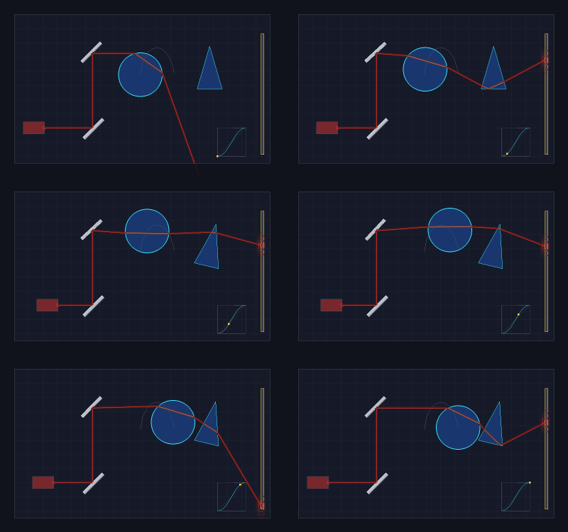

# Animation module: keyframes, easing, motion paths and double buffering

Owner: Sean · Namespace: `ob` · Headers: `include/optibench/Timeline.h`, `DoubleBuffer.h`, `Animator.h` ·
Sources: `src/Timeline.cpp`, `src/Animator.cpp` · Tests: `tests/test_timeline.cpp`, `tests/test_animator.cpp` ·
Demo: `demos/animation_demo.cpp`



*`demo_animation` contact sheet: six frames, 0.8 s apart, left to right and top to bottom. The top mirror swings on
keyframes, the laser slides out and back, the lens glides along a Bézier motion path (the dim arc) and the prism turns
with an overshooting ease. The inset at the bottom right is the lens's Bézier easing curve, and the yellow dot marks the
current moment. The beam is re-traced on every frame.*

---

## 1. Design

```
                ┌────────────── Timeline.h: pure math, no drawing ──────────────┐
                │                                                               │
  Clock ──t──►  │  Track / Vec2Track ── keyframes ──► ease(u) ──► lerp(a, b, e)  │──► value
  (delta time)  │  MotionPath ───────── curve ──────► ease(u) ──► arc length ──► │──► point, heading
                │                         ▲                                     │
                │     easeIn / easeOut / easeInOut / CubicBezierEasing ─────────┘
                └───────────────────────────────────────────────────────────────┘
                                          │ values
                                          ▼
  Animator::step(dt):  clock.advance(dt) → bindings write element.transform → scene.render(back)
                       → overlays(back) → buffers.swap() → front is the finished frame
                                                                     │
                       Animator::run(duration, fps, present) ────────┴──► present(front): save .bmp
```

* **Animation only touches transforms.** Every element on the bench has a public `Transform2D`
  (position, rotation, scale), as described in `Scene.h`. The engine writes those values and then calls
  `scene.render()`. Beams are traced again from scratch on every frame, so reflection and refraction are
  always correct for the current pose and are never animated directly.
* **Timing and path are separate.** An *easing curve* lives in a (time, progress) graph and only decides
  *when* the element has got how far. A *motion path* lives in the scene and decides *where* it goes. They
  combine as `position = path(ease(u))`. That is why one Bézier class serves both purposes.
* **Animation follows time, not frames.** Every track is sampled at the clock's elapsed seconds. The frame
  rate only decides how often samples are taken, so the same animation lasts the same time at 10 fps or at
  60 fps (a test checks this).
* **Reuse, don't duplicate.** Bézier easing and motion paths are built on Cyprian's `curves::Bezier` and
  `curves::CompositeBezier`, so de Casteljau evaluation, derivatives and Gauss-Legendre arc length are not
  re-implemented. The demo draws with the existing `drawLine` and `curves::drawCurve`.
* **Value types.** Tracks, easings and paths are copyable values. The `Animator` stores its own copies, so
  a track you build and pass in can go out of scope safely.

### Files

| File | Contents |
|---|---|
| `Timeline.h` / `Timeline.cpp` | `lerp`; `linear`, `easeIn`, `easeOut`, `easeInOut`; `Easing`; `CubicBezierEasing`; `BasicKeyframe<T>`, `BasicTrack<T>` (`Keyframe`, `Track`, `Vec2Track`); `MotionPath`; `Clock`; `RealTimeSource`; `loopTime`, `pingPongTime` |
| `DoubleBuffer.h` | `DoubleBuffer`: two `Framebuffer`s, `back()`, `front()`, `swap()` (header only) |
| `Animator.h` / `Animator.cpp` | `FrameInfo`; `Animator`: bindings, updates, overlays, `step()`, `run()` |
| `tests/test_timeline.cpp` | lerp, easing properties, Bézier easing inversion and presets, track sampling, motion paths, clock |
| `tests/test_animator.cpp` | double-buffer roles and swap, the loop's frame times, frame-rate independence, path binding, overlays, errors |
| `demos/animation_demo.cpp` | the four animations above, writing `output/frames/anim_####.bmp` and the contact sheet |

---

## 2. Animation techniques and their implementation

The engine uses nine animation techniques. For each one, this section says what it is, why the project
uses it, and quotes the code that implements it. Extracts are copied from the source. Lines marked `// ...`
were left out for brevity, and each extract links to its location. The math behind the techniques is in
[section 4](#4-the-math-briefly).

| # | Technique | Implemented by | Seen in the demo |
|---|---|---|---|
| 2.1 | Keyframe animation | `BasicTrack<T>::add` | all four animated elements |
| 2.2 | Tweening (linear interpolation) | `lerp`, `BasicTrack<T>::sample` | laser slide, mirror swing |
| 2.3 | Easing (ease-in / ease-out) | `easeIn`, `easeOut`, `easeInOut` | mirror swing, laser slide |
| 2.4 | Bézier easing curves | `CubicBezierEasing` | lens timing (inset graph), prism overshoot |
| 2.5 | Motion paths with constant speed | `MotionPath` | lens gliding along the arc |
| 2.6 | Transform animation | `Animator::animate*` bindings | every element's pose |
| 2.7 | Delta-time updates | `Clock` | the whole timeline |
| 2.8 | Double buffering | `DoubleBuffer` | every frame |
| 2.9 | The animation loop | `Animator::step`, `Animator::run` | the 61 frames |

### 2.1 Keyframe animation

**What it is.** The animator sets a value only at key moments, such as "the mirror is at 135° at 0 s and at
138° at 1.2 s". The engine computes every frame in between.

**Why.** A whole motion is described by a few numbers instead of one value per frame, and changing the frame
rate does not change the animation.

**Implementation.** A keyframe stores a time, a value, and the easing for the segment that starts at it.
`add` inserts it in time order with a binary search (`upper_bound`), so keyframes can be added in any order.
If two keyframes share a time, the new one goes after the existing one, which makes an instant jump.

[Timeline.h:114](../include/optibench/Timeline.h#L114)
```cpp
template <class T>
struct BasicKeyframe {
    double time = 0.0;      // seconds
    T value{};
    Easing ease = linear;
};
```

[Timeline.h:138](../include/optibench/Timeline.h#L138)
```cpp
BasicTrack& add(double time, T value, Easing ease = linear) {
    if (!std::isfinite(time)) throw std::invalid_argument("BasicTrack::add: time must be finite");
    if (!ease) throw std::invalid_argument("BasicTrack::add: easing must not be empty");
    const auto at = std::upper_bound(keys_.begin(), keys_.end(), time,
                                     [](double t, const Key& k) { return t < k.time; });
    keys_.insert(at, Key{time, std::move(value), std::move(ease)});
    return *this;
}
```

`BasicTrack` is a template, so the same code animates single numbers (`Track`, used for rotation) and points
(`Vec2Track`, used for position and scale).

### 2.2 Tweening by linear interpolation

**What it is.** "In-betweening": computing the frames between two keyframes. The lecture form is
`lerp(a, b, u) = a + (b − a)·u`, where `u ∈ [0, 1]` is how far through the segment we are.

**Implementation.** `lerp` exists for numbers and for `Vec2` points.

[Timeline.cpp:16](../src/Timeline.cpp#L16)
```cpp
double lerp(double a, double b, double t) { return a + (b - a) * t; }

Vec2 lerp(const Vec2& a, const Vec2& b, double t) { return a + (b - a) * t; }
```

`sample` finds the two keyframes on either side of `t`, turns `t` into the segment's local `u`, eases it,
and interpolates. Outside the keyframes it holds the first or last value.

[Timeline.h:148](../include/optibench/Timeline.h#L148)
```cpp
T sample(double t) const {
    if (keys_.empty()) return T{};
    if (t <= keys_.front().time) return keys_.front().value;
    if (t >= keys_.back().time) return keys_.back().value;

    // first keyframe strictly after t; the one before it starts the segment containing t
    const auto next = std::upper_bound(keys_.begin(), keys_.end(), t,
                                       [](double v, const Key& k) { return v < k.time; });
    const auto prev = next - 1;
    const double u = (t - prev->time) / (next->time - prev->time);   // span > 0 here
    return lerp(prev->value, next->value, prev->ease(u));
}
```

### 2.3 Easing: ease-in, ease-out, ease-in-out

**What it is.** Pure linear tweening moves at constant speed and starts and stops abruptly, which looks
mechanical. Easing reshapes `u` before interpolating, so motion speeds up from rest (ease-in), slows into
its target (ease-out), or both.

**Implementation.** Quadratic curves. `easeInOut` joins two halves at `(0.5, 0.5)` where both have slope 2,
so the speed never jumps. Inputs are clamped so every easing maps exactly 0 to 0 and 1 to 1.

[Timeline.cpp:23](../src/Timeline.cpp#L23)
```cpp
double linear(double t) { return clamp01(t); }

double easeIn(double t) {
    t = clamp01(t);
    return t * t;
}

double easeOut(double t) {
    t = clamp01(t);
    const double r = 1.0 - t;
    return 1.0 - r * r;
}

double easeInOut(double t) {
    // two quadratic halves meeting at (0.5, 0.5) with matching slope (2), so speed is continuous
    t = clamp01(t);
    if (t < 0.5) return 2.0 * t * t;
    const double r = 1.0 - t;
    return 1.0 - 2.0 * r * r;
}
```

An easing is any `std::function<double(double)>` (`Easing`), so each keyframe segment can pick its own.

### 2.4 Bézier easing curves

**What it is.** A cubic Bézier from `(0,0)` to `(1,1)` drawn in a graph of time progress (x) against eased
progress (y). Moving the two inner control points designs any timing curve, including ones that overshoot.
This is the same model as CSS `cubic-bezier()` and the curve editors in animation software.

**Implementation.** The constructor builds the cubic with Cyprian's `curves::Bezier` and rejects x values
outside `[0, 1]`, because x(s) must never decrease for the solve below to have one answer.

[Timeline.cpp:47](../src/Timeline.cpp#L47)
```cpp
CubicBezierEasing::CubicBezierEasing(double x1, double y1, double x2, double y2)
    : curve_({Vec2{0.0, 0.0}, Vec2{x1, y1}, Vec2{x2, y2}, Vec2{1.0, 1.0}}) {
    // ... (rejects non-finite values)
    if (x1 < 0.0 || x1 > 1.0 || x2 < 0.0 || x2 > 1.0)
        throw std::invalid_argument("CubicBezierEasing: x1 and x2 must be in [0, 1]");
}
```

The curve parameter `s` is not time, so easing a time progress `u` means first solving `x(s) = u`. Newton's
method does this in a few steps. Bisection is the safe fallback where the curve is nearly flat.

[Timeline.cpp:62](../src/Timeline.cpp#L62)
```cpp
// Newton's method on f(s) = x(s) - u, starting from s = u (exact for a linear x(s))
double s = u;
for (int i = 0; i < 8; ++i) {
    const double f = curve_.evaluate(s).x - u;
    if (std::fabs(f) < tol) return s;
    const double df = curve_.derivative(s).x;
    if (std::fabs(df) < 1e-6) break;            // flat spot: Newton would jump away
    const double next = s - f / df;
    if (next < 0.0 || next > 1.0) break;        // left the curve: fall back
    s = next;
}

// bisection: x(s) is non-decreasing on [0, 1] because x1, x2 are in [0, 1]
double lo = 0.0, hi = 1.0;
s = u;
for (int i = 0; i < 60; ++i) {
    const double x = curve_.evaluate(s).x;
    if (std::fabs(x - u) < tol) break;
    (x < u ? lo : hi) = s;
    s = 0.5 * (lo + hi);
}
return s;
```

The eased value is the curve's height at that parameter:

[Timeline.cpp:86](../src/Timeline.cpp#L86)
```cpp
double CubicBezierEasing::operator()(double u) const {
    u = clamp01(u);
    if (u <= 0.0) return 0.0;
    if (u >= 1.0) return 1.0;
    return curve_.evaluate(solveParam(u)).y;
}
```

Because it has `operator()`, a `CubicBezierEasing` can be used anywhere an `Easing` is expected, for
example `track.add(0.0, a, CubicBezierEasing::backOut())`.

### 2.5 Motion paths with constant speed

**What it is.** Easing decides *when*. A motion path decides *where*: the element travels along a curve in
the scene instead of the straight line that `lerp` gives between keyframes.

**Why constant speed.** A Bézier's parameter does not advance evenly along its length: the element would
rush where control points are far apart and crawl where they are bunched. Reparameterizing by arc length
means equal times cover equal distances, so only the chosen easing changes the speed.

**Implementation.** The constructor builds a table of cumulative arc length using the curve module's
quadrature:

[Timeline.cpp:105](../src/Timeline.cpp#L105)
```cpp
// cumulative arc length, sampled finely per segment with the curve's own quadrature
params_.push_back(0.0);
lengths_.push_back(0.0);
double before = 0.0;    // length of all earlier segments
for (std::size_t i = 0; i < curve_.segmentCount(); ++i) {
    const curves::Bezier& seg = curve_.segment(i);
    for (std::size_t k = 1; k <= kSamplesPerSegment; ++k) {
        const double local = static_cast<double>(k) / kSamplesPerSegment;
        params_.push_back(static_cast<double>(i) + local);
        lengths_.push_back(before + seg.arcLength(0.0, local));
    }
    before = lengths_.back();
}
```

To find the parameter at a given distance, the table gives a first guess. Newton's method then refines it,
using the fact that the derivative of arc length is the curve's speed `|C′(u)|`:

[Timeline.cpp:140](../src/Timeline.cpp#L140)
```cpp
// binary search the table, then interpolate linearly inside the bracketing interval
const auto it = std::lower_bound(lengths_.begin(), lengths_.end(), s);
// ... (ends of the table)
const double guess = lerp(params_[i - 1], params_[i], f);

// refine with Newton's method on L(u) - s inside the bracket, where L'(u) = |C'(u)| (the speed)
// ...
double u = guess;
for (int k = 0; k < 3; ++k) {
    const double local = u - static_cast<double>(seg);
    const double err = before + b.arcLength(0.0, local) - s;
    const double speed = b.derivative(local).length();
    if (std::fabs(err) < 1e-10 || speed <= 1e-12) break;
    u = std::clamp(u - err / speed, lo, hi);
}
return u;
```

Easing and path combine here: time becomes eased progress, progress becomes distance, and distance becomes
a point on the curve. `heading` turns the curve's tangent into an angle so an element can face where it is
going.

[Timeline.cpp:130](../src/Timeline.cpp#L130)
```cpp
double MotionPath::progress(double t) const {
    const double u = clamp01((t - t0_) / (t1_ - t0_));
    return clamp01(ease_(u));
}
// ...
double MotionPath::paramAt(double t) const {
    const double e = progress(t);
    if (constantSpeed_) return paramAtLength(e * length());
    return e * curve_.paramMax();
}

Vec2 MotionPath::sample(double t) const { return curve_.evaluate(paramAt(t)); }

double MotionPath::heading(double t) const {
    const Vec2 d = curve_.tangent(paramAt(t));
    return (d.x == 0.0 && d.y == 0.0) ? 0.0 : std::atan2(d.y, d.x);
}
```

### 2.6 Transform animation

**What it is.** Instead of drawing new artwork for each frame, the engine animates each object's transform
(position, rotation, scale) and redraws the scene. The lecture's composite transform `T·R·S` places every
element.

**Why.** The light beams are never animated directly. They are traced again from the new poses on every
frame, so reflection and refraction stay physically correct.

**Implementation.** A binding looks up the element by name once. It then stores a small function that
samples the track and writes the result into the element's transform:

[Animator.cpp:14](../src/Animator.cpp#L14)
```cpp
void Animator::animateRotation(const std::string& element, Track track) {
    if (track.empty()) throw std::invalid_argument("Animator::animateRotation: track has no keyframes");
    OpticalElement* e = &require(element);     // elements are owned by unique_ptr: the address is stable
    updates_.push_back([e, track = std::move(track)](double t) { e->transform.rotation = track.sample(t); });
}
```

[Animator.cpp:32](../src/Animator.cpp#L32)
```cpp
void Animator::animatePath(const std::string& element, MotionPath path, bool orient, double rotationOffset) {
    OpticalElement* e = &require(element);
    updates_.push_back([e, path = std::move(path), orient, rotationOffset](double t) {
        e->transform.position = path.sample(t);
        if (orient) e->transform.rotation = path.heading(t) + rotationOffset;
    });
}
```

`animatePosition` and `animateScale` follow the same pattern with a `Vec2Track`.

### 2.7 Delta-time updates

**What it is.** Each frame advances the clock by the real time that passed, `dt`, and animation is sampled at
the elapsed time. Nothing advances "one step per frame".

**Why.** The animation lasts the same number of seconds at any frame rate. Because values are computed from
the time rather than accumulated each frame, rounding errors do not build up. `test_animator` checks that
10 fps and 30 fps give identical poses at t = 1 s.

**Implementation.** `advance` also supports pausing and playback speed (slow motion):

[Timeline.cpp:181](../src/Timeline.cpp#L181)
```cpp
double Clock::advance(double dt) {
    if (!std::isfinite(dt) || dt < 0.0) throw std::invalid_argument("Clock::advance: dt must be finite and >= 0");
    dt_ = paused_ ? 0.0 : dt * speed_;
    time_ += dt_;
    ++frames_;
    return dt_;
}
```

For a live window, `dt` would come from the system clock instead of a fixed `1/fps`:

[Timeline.cpp:194](../src/Timeline.cpp#L194)
```cpp
double RealTimeSource::lap() {
    const auto now = std::chrono::steady_clock::now();
    const double dt = std::chrono::duration<double>(now - last_).count();
    last_ = now;
    return dt;
}
```

Looping and back-and-forth playback are just functions of time:

[Timeline.cpp:201](../src/Timeline.cpp#L201)
```cpp
double loopTime(double t, double period) {
    if (period <= 0.0) return t;
    const double r = std::fmod(t, period);
    return r < 0.0 ? r + period : r;
}

double pingPongTime(double t, double period) {
    if (period <= 0.0) return t;
    const double r = loopTime(t, 2.0 * period);
    return r <= period ? r : 2.0 * period - r;
}
```

### 2.8 Double buffering

**What it is.** Two framebuffers. The next frame is drawn into the hidden *back* buffer while the *front*
buffer holds the last finished frame. When drawing is complete the two swap roles.

**Why.** Rendering a frame takes many steps: clear, panel, grid, elements, beams, overlays. Without a second
buffer, a viewer or a saved image could catch a half-drawn frame, which shows up as flicker or tearing.

**Implementation.** The swap flips an index, so it is O(1) and copies no pixels:

[DoubleBuffer.h:24](../include/optibench/DoubleBuffer.h#L24)
```cpp
Framebuffer& back() { return buffers_[1 - front_]; }
const Framebuffer& back() const { return buffers_[1 - front_]; }
const Framebuffer& front() const { return buffers_[front_]; }

// the finished back buffer becomes the front buffer and vice versa
void swap() noexcept {
    front_ = 1 - front_;
    ++swaps_;
}
// ...
std::array<Framebuffer, 2> buffers_;
int front_ = 0;
```

### 2.9 The animation loop

**What it is.** The cycle that ties the techniques together on every frame: advance time, update the
objects, draw off-screen, swap, show.

**Implementation.** `step` is one pass of the loop. Each line is one of the techniques above:

[Animator.cpp:40](../src/Animator.cpp#L40)
```cpp
FrameInfo Animator::step(double dt) {
    const double applied = clock_.advance(dt);                         // 2.7 delta time
    const FrameInfo info{frames_, clock_.time(), applied};

    for (const Update& u : updates_) u(info.time);                     // 2.1-2.6 sample tracks, write transforms
    scene_.render(buffers_.back());                                    // draw into the back buffer
    for (const Overlay& o : overlays_) o(buffers_.back(), info);       // extra drawing, still off-screen
    buffers_.swap();                                                   // 2.8 double buffering

    ++frames_;
    return info;
}
```

(The comments marking techniques were added for this document. The source has the same code without them.)

`run` drives the loop offline at a fixed time step. It hands each finished front buffer to a callback, which
in the demo saves it as a `.bmp`:

[Animator.cpp:53](../src/Animator.cpp#L53)
```cpp
int Animator::run(double duration, double fps, const Present& present) {
    // ... (rejects fps <= 0 and negative durations)
    const double dt = 1.0 / fps;
    const int steps = static_cast<int>(std::lround(duration * fps));
    int presented = 0;
    for (int i = 0; i <= steps; ++i) {
        const FrameInfo info = step(i == 0 ? 0.0 : dt);     // first frame shows the starting pose
        ++presented;
        if (present && !present(buffers_.front(), info)) break;
    }
    return presented;
}
```

---

## 3. Usage

### Tweening and easing

```cpp
#include "optibench/Timeline.h"
using namespace ob;

lerp(0.0, 10.0, 0.25);                 // 2.5
lerp(Vec2{0, 0}, Vec2{10, 20}, 0.5);   // (5, 10)

easeIn(0.5);      // 0.25  slow start
easeOut(0.5);     // 0.75  fast start
easeInOut(0.5);   // 0.5   slow at both ends

// Bézier easing curve: control points P1 = (x1, y1), P2 = (x2, y2)
CubicBezierEasing custom(0.3, 0.0, 0.2, 1.0);
custom(0.5);                            // eased progress at half time
CubicBezierEasing::easeInOut()(0.5);    // presets: ease, easeIn, easeOut, easeInOut, backOut
```

Any `double(double)` callable that maps 0 to 0 and 1 to 1 can be used as an `Easing`, including the
functions above, a `CubicBezierEasing`, or a lambda.

### Keyframe tracks

```cpp
Track rotation;                                   // doubles: rotation, any single number
rotation.add(0.0, 0.0, easeInOut)                 // easing shapes the segment that STARTS here
        .add(1.5, 0.3, CubicBezierEasing::ease())
        .add(3.0, 0.0);
rotation.sample(0.75);                            // tweened value at 0.75 s

Vec2Track position;                               // points: position, scale
position.add(0.0, {100, 200}).add(2.0, {300, 200}, easeOut).add(4.0, {300, 120});
```

* Keyframes can be added in any order because they are kept sorted.
* Before the first keyframe and after the last one, the value holds at that keyframe (clamped).
* Two keyframes at the same time give an instant jump, which is useful for a cut.

### Motion paths

```cpp
#include "optibench/curves/CatmullRom.h"

curves::Bezier arc({{395, 210}, {405, 110}, {475, 110}, {490, 205}});
MotionPath glide(arc, 0.0, 4.0, CubicBezierEasing::easeInOut());   // constant speed by default
glide.sample(1.0);     // point on the arc at 1 s
glide.heading(1.0);    // direction of travel, radians

// through a list of points: a Catmull-Rom spline passes through every one of them
curves::CatmullRom rail({{100, 300}, {250, 200}, {400, 320}, {550, 220}});
MotionPath tour(rail.toBezier(), 0.0, 6.0, linear);
```

Pass `constantSpeed = false` to step the curve parameter directly. Speed then depends on how far apart the
control points are, which is mostly useful for comparison or teaching.

### Animating a scene

```cpp
#include "optibench/Animator.h"

Scene scene = buildScene();
DoubleBuffer buffers(800, 500);
Animator anim(scene, buffers);

anim.animateRotation("mirrorTop", rotation);
anim.animatePosition("laser", position);
anim.animatePath("lens", glide);                       // add `true` to face the direction of travel
anim.addUpdate([&](double t) { /* anything else, e.g. change a colour */ });
anim.addOverlay([&](Framebuffer& back, const FrameInfo& f) { /* draw labels or guides on top */ });

// offline: frames at t = 0, 1/15, ..., 4 s, each handed over once it is the front buffer
anim.run(4.0, 15.0, [](const Framebuffer& front, const FrameInfo& f) {
    char name[64];
    std::snprintf(name, sizeof name, "output/frames/anim_%04d.bmp", f.index);
    return front.saveBMP(name);                        // returning false stops the loop
});
```

* For a live window, call `anim.step(timer.lap())` in your own loop, where `timer` is a `RealTimeSource`,
  and blit `buffers.front()` to the window.
* `anim.clock()` exposes `pause()`, `resume()` and `setSpeed()` (0.5 gives slow motion).
* To loop an animation, sample a track at `loopTime(t, period)` or `pingPongTime(t, period)` from an
  `addUpdate`.

---

## 4. The math, briefly

**Linear interpolation.** `lerp(a, b, u) = a + (b − a)·u`. This gives `a` at `u = 0` and `b` at `u = 1`,
and moves at a constant rate in between.

**Quadratic easing.** These remap `u ∈ [0, 1]` before interpolating:

```
easeIn(u)    = u²                      speed 2u: starts at 0
easeOut(u)   = 1 − (1 − u)²            speed 2(1 − u): ends at 0
easeInOut(u) = 2u²            u < ½    the two halves meet at (½, ½) with the same
             = 1 − 2(1 − u)²  u ≥ ½    slope (2), so the speed has no jump
```

**Cubic Bézier easing.** The curve has `P0 = (0,0)`, `P1 = (x1,y1)`, `P2 = (x2,y2)` and `P3 = (1,1)`:

```
x(s) = 3(1−s)²s·x1 + 3(1−s)s²·x2 + s³          (time progress)
y(s) = 3(1−s)²s·y1 + 3(1−s)s²·y2 + s³          (eased progress)
```

The curve parameter `s` is not time. To ease a time progress `u`:

1. **Newton's method** on `f(s) = x(s) − u`. It starts from `s = u`, which is exact when `x` is linear, and
   iterates `s ← s − f(s)/x′(s)` up to 8 times until `|f| < 1e−9`.
2. **Bisection** on `[0, 1]` is the fallback when `x′(s) ≈ 0` (for example `x1 = 0`, where the curve leaves
   flat) or when a Newton step jumps outside `[0, 1]`.
3. Return `y(s)`. Exactly 0 and 1 are returned at the ends.

The solve has exactly one answer only if `x(s)` never decreases. That holds when `x1, x2 ∈ [0, 1]`, so the
constructor rejects other values. `y1` and `y2` are free: values above 1 overshoot the target (`backOut`)
and values below 0 anticipate it.

**Keyframe sampling.** Find the segment `prev.time ≤ t < next.time` by binary search (`upper_bound`), then

```
u     = (t − prev.time) / (next.time − prev.time)
value = lerp(prev.value, next.value, prev.ease(u))
```

**Arc-length reparameterization (constant-speed paths).** The arc length up to parameter `u` is
`L(u) = ∫₀ᵘ |C′(v)| dv`. To travel a distance `s = ease(u)·L_total`, we need the parameter where `L = s`:

1. At construction, a cumulative table of `L` is built at 64 parameter steps per segment, using the curve
   module's adaptive Gauss-Legendre `arcLength`.
2. A lookup binary-searches the table and interpolates linearly for a first guess.
3. Up to 3 Newton steps follow, `u ← u − (L(u) − s) / |C′(u)|`, kept inside the table interval. Since
   `L′(u) = |C′(u)|` (the speed), this converges very quickly. On a test curve with unevenly spaced
   control points, this brought the worst-case error from about 0.009 px (table alone) to about 1e−10 px.

**Delta time.** `Clock::advance(dt)` adds `dt · speed` to the elapsed time, or adds nothing while paused.
Animation is a function of elapsed time, `value = track.sample(time)`, rather than a value nudged a little
each frame. Because of that, rounding errors do not build up and the result does not depend on the frame
rate.

**Double buffering.** `DoubleBuffer` holds two framebuffers and an index `front ∈ {0, 1}`. `back()` is
`buffers[1 − front]`. `swap()` sets `front = 1 − front`, which is O(1) and copies no pixels. Each frame is
drawn completely into the back buffer (clear, panel, grid, elements, beams, overlays) before the swap, so
nothing ever displays or saves a half-drawn frame.

### Complexity

| Operation | Cost |
|---|---|
| `Track::add` | O(n) (sorted insert) |
| `Track::sample` | O(log n) for n keyframes |
| `CubicBezierEasing::operator()` | ≤ 8 Newton steps, or ≤ 60 bisection steps; each step evaluates a cubic, O(1) |
| `MotionPath` construction | 64 quadratures per segment |
| `MotionPath::sample` | O(log N) table search + ≤ 3 quadratures + one curve evaluation |
| `DoubleBuffer::swap` | O(1) |
| `Animator::step` | O(bindings) + one `scene.render()`, which dominates (full clear, fills and ray tracing) |

---

## 5. Trade-offs and limitations

* **Offline rendering.** `run()` uses a fixed `dt = 1/fps` and writes `.bmp` frames, which is deterministic
  and easy to test. There is no window yet. `RealTimeSource` and `step(dt)` are the parts a live loop
  would use.
* **Rotation is interpolated as a plain number.** Going from 350° to 10° turns 340° the long way round, not
  20°. If you want the short way, add keyframes with unwrapped angles (for example 350° → 370°).
* **Easing belongs to the starting keyframe.** In `add(time, value, ease)` the easing shapes the segment
  *after* that keyframe. The easing on the last keyframe is never used.
* **Overshoot is clamped on paths.** A `backOut` easing overshoots freely on a `Track`, but on a `MotionPath`
  the progress is clamped to `[0, 1]`, because a curve cannot be extended past its ends in a meaningful way.
* **Bindings run in the order they were added.** If two bindings write the same field (for example a
  position track and a path on the same element), the one added last wins.
* **Lifetimes.** `Animator` keeps a reference to the `Scene` and the `DoubleBuffer`, and pointers to the
  elements it animates, so the scene must outlive the animator. Element addresses are stable because
  `Scene` owns them through `unique_ptr`.
* **Cost of a frame.** Every frame re-renders the whole scene. That is fine at 800×500 offline. A live
  version would want only the changed region redrawn.

### Notes for teammates

* **To animate your element**, give it a unique name when you `emplace` it, then bind to that name. No
  changes to your module are needed.
* **New easings** need only map 0 to 0 and 1 to 1. Any `double(double)` callable can be passed as an
  `Easing`.
* **Any curve from the curves module** can be a motion path through its `CompositeBezier`. Use
  `CatmullRom::toBezier()` when you want the path to pass through given points.
* **Use overlays for drawing that belongs to the frame but not to the bench** (labels, guides, graphs).
  They draw on the back buffer before the swap, so they are double-buffered too.

---

