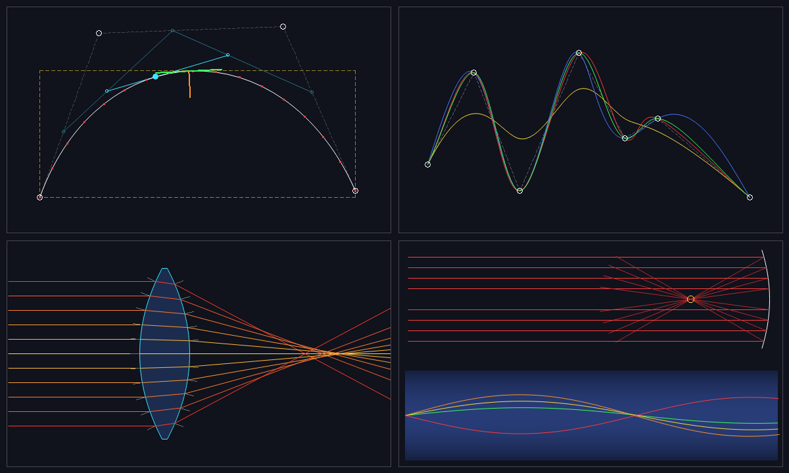

# Curves module: Bézier curves and splines

Owner: Cyprian Kamau · Namespace: `ob::curves` · Headers: `include/optibench/curves/` ·
Sources: `src/curves/` · Tests: `tests/curves/` · Demo: `demos/curves_demo.cpp`



*`demo_curves` output. Top left: anatomy of a cubic Bézier. Top right: four splines through the
same points. Bottom left: rays refracting through a lens whose faces are Bézier curves. Bottom
right: a parabolic mirror and a gradient-index fibre.*

---

## 1. Design

```
                     ┌──────────────── math only, no drawing ────────────────┐
  Bezier ─────┐      │                                                         │
  Hermite ────┤      │   CompositeBezier ──► flatten(tol) ──► Polyline ────────┼──► CurveRender ──► ob::drawLine
  CatmullRom ─┼─────►│   (chain of Bezier    bounds(), arcLength(), ...        │    (LineSink        (line module)
  NaturalCubic┤ toBezier()    segments)                                        │     concept)
  BSpline ────┘      │         │                                               │
  Nurbs ── toRationalBezier()  └──► intersectRay() / OpticalSurface ──► CurveHit ──► physics module
                     │                                         (point, oriented normal, frontFace)
                     └─────────────────────────────────────────────────────────┘
```

* **One shared geometry type.** Every spline converts exactly to a `CompositeBezier` (NURBS
  converts to rational Béziers). Flattening, bounds, arc length, ray intersection and drawing are
  written once, for Bézier segments, and every curve type gets them.
* **Rendering stays separate.** The math returns points, tangents, normals, curvatures and
  polylines. `CurveRender.h` is a thin adapter. It takes any `LineSink`, meaning anything
  callable as `sink(Vec2 a, Vec2 b)`, so the same code draws through Sharon's Bresenham or Wu
  lines, an SVG writer, or a recording test stub.
* **Reuse, don't duplicate.** The module uses `ob::Vec2`, `ob::Ray` and `ob::Hit` (shared
  headers), `distanceToSegment` and the line drawers (lines), `drawCircle` (circles), and
  `polygonArea` and `clipLineCohenSutherland` (clipping, used in the demo). It does not
  reimplement any line, circle or polygon algorithm.
* **Value types.** Curves own their control points in a `std::vector`. There are no raw owning
  pointers and no global state. Accessors are `const` and return `std::span`.
* **Explicit degenerate handling.** Invalid input throws `std::invalid_argument` with a
  message. Degenerate geometry (coincident control points, zero-length derivatives, collinear
  rays) returns documented values and never produces NaN or undefined behaviour. All tests also
  pass under clang's AddressSanitizer and UndefinedBehaviorSanitizer.

### Files

| Header | Contents |
|---|---|
| `CurveMath.h` | `Aabb`, `Polyline`, Bernstein basis, robust Bernstein root finder, Thomas tridiagonal solver, adaptive Gauss–Legendre quadrature, `ArcLengthTable`, knot parametrization |
| `Bezier.h` | arbitrary-degree Bézier: evaluation (closed form for degree ≤ 3, de Casteljau, Bernstein), derivatives, tangent, normal, curvature, split, degree elevation, adaptive and uniform flattening, tight and control bounds, arc length, arc-length reparametrization, closest point |
| `Composite.h` | piecewise Bézier chains, C0/G1/C1 detection and enforcement, closed chains |
| `CubicSpline.h` | natural cubic spline (C2, tridiagonal solve) |
| `Hermite.h` | cubic Hermite segments and C1 Hermite splines |
| `CatmullRom.h` | Catmull–Rom splines: uniform, centripetal, chordal, tension, open or closed |
| `BSpline.h` | B-splines of any degree: de Boor, Cox–de Boor basis, clamped and uniform knots, knot insertion (Boehm), Bézier extraction |
| `Nurbs.h` | rational Bézier and NURBS: exact circular arcs, circles, ellipses |
| `CurveEditor.h` | toolkit-independent editing model: hit-testing, drag, insert, delete, transactional rebuild |
| `OpticalCurve.h` | ray–curve intersection, `CurveHit`, `OpticalSurface`, parabolic and lens profiles |
| `RayPath.h` | ray tracing through gradient-index (GRIN) media, exported as a smooth curve |
| `CurveRender.h` | `LineSink` / `Flattenable` concepts and framebuffer helpers |
| `Curves.h` | umbrella header (safe to combine with either `Polygon.h` or `clip_fill.h`) |

---

## 2. Usage

Build and test from the repository root:

```bash
cmake -S . -B build
cmake --build build
ctest --test-dir build --output-on-failure   # all module tests, including the 9 curves suites
./build/demo_curves                           # writes output/curves_demo.bmp (.\build\demo_curves.exe on Windows)
```

### Bézier basics

```cpp
#include "optibench/curves/Bezier.h"
using namespace ob;
using namespace ob::curves;

Bezier c({{0, 0}, {100, 150}, {200, -150}, {300, 0}});   // cubic, any degree works
Vec2 p      = c.evaluate(0.25);
Vec2 t      = c.tangent(0.25);        // unit tangent
Vec2 n      = c.normal(0.25);         // tangent.perp()
double k    = c.curvature(0.25);      // signed, positive when turning towards normal()
auto [l, r] = c.split(0.5);           // two cubics that together are exactly c
Bezier q    = c.elevated();           // same curve, degree 4
Polyline poly = c.flatten(0.25);      // every curve point within 0.25 of the polyline
Aabb box    = c.bounds();             // tight box (derivative roots)
double len  = c.arcLength();
Polyline even = c.sampleByArcLength(20);  // 21 points equally spaced along the curve
```

### Splines

```cpp
#include "optibench/curves/BSpline.h"
#include "optibench/curves/CatmullRom.h"
#include "optibench/curves/CubicSpline.h"

std::vector<Vec2> pts{{0, 0}, {2, 3}, {5, 4}, {7, 1}, {10, 2}};

CatmullRom cr(pts, Parametrization::Centripetal);       // passes through every point
NaturalCubicSpline ns(pts);                             // C2, chordal knots by default
BSpline bs = BSpline::clamped(3, pts);                  // approximates, starts and ends on pts
bs.insertKnot(0.5);                                     // same curve, one more control point

CompositeBezier asBezier = bs.toBezier();               // every spline converts exactly
```

### Composite curves and continuity

```cpp
CompositeBezier chain;
chain.append(Bezier({{0, 0}, {1, 2}, {2, 2}, {3, 0}}));
chain.append(Bezier({{9, 9}, {4, 1}, {5, -1}, {6, 0}}), Continuity::C1);  // snaps and aligns segment 2
bool smooth = chain.continuity() >= Continuity::G1;     // true
```

### Drawing

```cpp
#include "optibench/curves/CurveRender.h"

Framebuffer fb(800, 600);
drawCurve(fb, cr.toBezier(), colors::Cyan);               // Bresenham via the line module
drawCurve(fb, cr.toBezier(), colors::Cyan, 0.25, true);   // anti-aliased (Wu)
drawControlPolygon(fb, pts, colors::Grey, colors::White);

// any callable works as a line sink: here, collecting segments for an SVG or a test
std::vector<std::pair<Vec2, Vec2>> segments;
drawCurve(c, 0.25, [&](Vec2 a, Vec2 b) { segments.emplace_back(a, b); });
```

### Optics: curved surfaces for the physics module

```cpp
#include "optibench/curves/OpticalCurve.h"

LensSpec spec;                          // optical axis along +x
spec.center = {250, 300};
spec.aperture = 200;
spec.frontSag = 30;                     // > 0 convex, < 0 concave, 0 flat
spec.backSag = 30;
OpticalSurface lens(lensProfile(spec), SurfaceKind::Refractive, 1.5);

Ray ray{{0, 280}, {1, 0}};
for (const CurveHit& h : lens.intersect(ray)) {   // sorted by distance
    // h.point, h.distance         where the ray hits
    // h.normal                    unit, faces the ray (dot(h.normal, d) < 0): plug into Snell / reflection
    // h.frontFace                 true: entering the glass (n1 = 1, n2 = 1.5); false: leaving it
    // h.surfaceNormal             outward normal of the closed profile
    // h.tangential                grazing hit
}
Hit nearest = toHit(lens.intersect(ray));          // the project's ob::Hit, if the caller prefers it

OpticalSurface mirror(CompositeBezier({parabolicProfile({700, 300}, {-1, 0}, 120.0, 80.0)}),
                      SurfaceKind::Reflective);   // exact parabola: parallel rays meet at the focus
```

The integrated demo can trace through these surfaces with its existing `refractDir` and
`reflectDir`, using `h.normal`. Pick `n1`/`n2` from `h.frontFace`.

### Gradient-index ray paths

```cpp
#include "optibench/curves/RayPath.h"

auto index = [](Vec2 p) { return 1.55 - 0.00006 * (p.y - 300) * (p.y - 300); };   // GRIN fibre
GrinOptions opts;
opts.step = 2.0;
opts.stop = [](Vec2 p) { return p.x > 900; };
RayPath path = traceGradientIndex(index, {0, 300}, {1, -0.2}, opts);
CompositeBezier rayCurve = path.toCurve();    // C1 curve through the samples; draw or measure it
```

### Interactive editing (data model)

```cpp
#include "optibench/curves/CurveEditor.h"

CurveEditor editor(pts, builders::catmullRom());
if (editor.beginDrag(mouse, /*pick radius*/ 6.0)) {
    editor.dragTo(mouse2);                    // curve is rebuilt automatically
    editor.endDrag();
}
editor.insertNear(click);                     // insert on the nearest control-polygon edge
if (auto i = editor.hitTest(click, 6.0)) editor.remove(*i);
editor.setBuilder(builders::clampedBSpline(3));  // switch curve type, keep the points
// redraw when editor.revision() changes
```

---

## 3. The math, briefly

**Bézier.** B(t) = Σ Bᵢ,ₙ(t) Pᵢ with Bernstein polynomials Bᵢ,ₙ(t) = C(n,i) tⁱ(1−t)ⁿ⁻ⁱ.
De Casteljau's algorithm evaluates by repeated linear interpolation and also yields the control
points of the two halves, which is how `split` works. Because it uses only convex combinations,
it is numerically stable. The derivative is the degree n−1 Bézier with control points
n(Pᵢ₊₁ − Pᵢ) (the hodograph). Degree elevation uses Qᵢ = (i/(n+1)) Pᵢ₋₁ + (1 − i/(n+1)) Pᵢ.

**Adaptive flattening.** The curve is split at t = ½ until every interior control point lies
within the tolerance of the chord P₀Pₙ. The curve lies inside the convex hull of its control
points, and the distance to the chord is convex, so every curve point is then within the
tolerance of the polyline. The tests check this by dense sampling. Flat regions take one
segment and tight bends take many, unlike fixed-step sampling.

**Tight bounds.** Each coordinate's extremes are at the endpoints or at roots of that
coordinate of B′(t). Those roots come from the Bernstein root finder.

**Bernstein root finder** (`bernsteinRoots`). Subdivide while the coefficient range contains
zero, which is a convex-hull rejection test. Once an interval has exactly one coefficient sign
change, Descartes' rule for Bernstein polynomials guarantees exactly one root there, and
bisection finds it to full precision. Remaining candidates come from touching roots (tangencies).
These are grouped into runs, polished with Newton's method, and merged.

**Arc length.** L = ∫|B′(t)| dt by adaptive 5-point Gauss–Legendre quadrature. Reparametrization
inverts s(t) with a cumulative table plus safeguarded Newton iteration (s′(t) = |B′(t)|).

**Natural cubic spline.** Unknown second derivatives Mᵢ satisfy
hᵢ₋₁Mᵢ₋₁ + 2(hᵢ₋₁+hᵢ)Mᵢ + hᵢMᵢ₊₁ = 6[(Pᵢ₊₁−Pᵢ)/hᵢ − (Pᵢ−Pᵢ₋₁)/hᵢ₋₁] with M₀ = Mₙ = 0. The
system is tridiagonal and diagonally dominant, so the Thomas algorithm solves it in O(n).

**Catmull–Rom.** The tangents come from the Barry–Goldman pyramid with knot gaps |ΔP|^α.
α = 0 gives the classic uniform spline (m = (Pᵢ₊₁ − Pᵢ₋₁)/2), α = ½ centripetal (no cusps or
self-intersections within a segment), and α = 1 chordal. Tension scales the tangents by (1 − τ).

**B-splines.** C(u) = Σ Nᵢ,ₚ(u) Pᵢ. De Boor's algorithm evaluates with p rounds of affine
combinations. Boehm's algorithm inserts a knot without changing the curve. Inserting every
interior knot up to multiplicity p turns the spline into its Bézier pieces.

**NURBS.** Weighted control points in homogeneous coordinates (wx, wy, w). Polynomial algorithms
run on the homogeneous form, followed by one division. A rational quadratic with weights
(1, cos(θ/2), 1) is an exact circular arc of angle θ.

**Ray–curve intersection.** A ray o + s·d lies on the line cross(d, p − o) = 0. Substituting the
curve gives the scalar Bernstein polynomial f(t) = Σ Bᵢ(t)·cross(d, Pᵢ − o). Its roots are
exactly the crossings, and the ray distance is s = d·(B(t) − o). This is Bézier clipping with
the fat line collapsed onto the ray: the convex hull of the 1D coefficients is the bounding
interval of the curve's distance to the ray. For rational curves the coefficients are
wᵢ·cross(d, Pᵢ − o).

**GRIN rays.** The ray equation d/ds(n dr/ds) = ∇n becomes dr/dσ = T, dT/dσ = ∇(n²)/2, using
T = n dr/ds and dσ = ds/n. This system is integrated with RK4. When n² is linear in position the
exact path is a parabola, which RK4 and the Hermite export both reproduce exactly. A test checks
this.

### Complexity

n = degree, N = number of segments or control points, k = flattened segment count.

| Operation | Cost |
|---|---|
| `evaluate` (degree ≤ 3 / general) | O(1) / O(n²) |
| `split`, `elevated`, `hodograph` | O(n²) / O(n) / O(n) |
| `flatten(tol)` | O(k·n²); k grows like 1/√tol for smooth curves |
| `bounds` | O(n²·log(1/ε)) per extreme |
| `arcLength` | O(panels·n²), panels adaptive |
| Natural cubic spline build | O(N) (Thomas) |
| B-spline `evaluate` / `insertKnot` / `toBezier` | O(p²) / O(N) / O(N·p) insertions |
| Ray–Bézier intersection | O(n² log(1/ε)) per root, plus O(n²) per subdivision step; rejected in O(n) when all coefficients share a sign |
| GRIN trace | O(steps) evaluations of n (4 per step, plus 4 more for numeric gradients) |

---

## 4. Trade-offs and limitations

* **Root isolation instead of iterative Bézier clipping.** The ray-curve and bounds problems
  are both reduced to roots of a scalar Bernstein polynomial. This handles tangent rays and
  near-misses deterministically, with no 2D clipping loop to tune. Two distinct roots closer
  than about 10⁻⁶ in t are merged into one.
* **Collinear rays.** A ray running exactly along a straight segment has infinitely many
  intersections, and that segment reports none. Physically the ray grazes a flat face.
* **Grazing hits** are flagged `tangential`. Their facing normal points away from the centre of
  curvature, because a grazing ray is always on the convex side. They can be filtered out with
  `RayCurveOptions::includeTangential = false`.
* **Closed G1/C1 chains of quadratics are over-constrained.** One middle control point sets the
  tangent at both ends. Use cubic segments for smooth closed loops.
* **Catmull–Rom and natural splines remove consecutive duplicate points** rather than dividing
  by a zero knot gap. `CurveEditor` rejects (and rolls back) edits that leave too few distinct
  points.
* **`OpticalSurface` takes polynomial profiles.** NURBS curves expose the same hit data through
  `Nurbs::intersect`.
* **Coordinates are y-agnostic.** "Left" and "counter-clockwise" refer to y-up maths. On the
  y-down framebuffer the same `perp()` normal appears clockwise. Closed optical profiles detect
  their orientation and always report outward normals.

### Notes for teammates

* `ctest` is enabled in the root `CMakeLists.txt`, and the five existing tests are registered
  too. Run them all with `ctest --test-dir build --output-on-failure`.
* **Convention mismatch found while testing:** `rayCircleIntersect` returns `Hit.t` in units of
  `|direction|`, while `Ray.h` documents `t` as a distance and `intersectRaySegment` normalizes
  the direction. With non-unit directions the two modules disagree by a factor of `|direction|`.
  The curves module follows `Ray.h`.
* `Polygon.h` and `clip_fill.h` both define `ob::Polygon`, so they cannot be included in the same
  file. The curves headers include neither.

---

## 5. References

1. G. Farin, *Curves and Surfaces for CAGD: A Practical Guide*, 5th ed., Morgan Kaufmann, 2002.
2. L. Piegl and W. Tiller, *The NURBS Book*, 2nd ed., Springer, 1997. (de Boor, knot insertion A5.1, basis A2.2, circular arcs A7.1)
3. C. de Boor, *A Practical Guide to Splines*, Springer, 1978.
4. T. W. Sederberg and T. Nishita, "Curve intersection using Bézier clipping," *Computer-Aided Design* 22(9), 1990.
5. P. J. Barry and R. N. Goldman, "A recursive evaluation algorithm for a class of Catmull–Rom splines," *SIGGRAPH* 1988.
6. C. Yuksel, S. Schaefer and J. Keyser, "Parameterization and applications of Catmull–Rom curves," *Computer-Aided Design* 43(7), 2011.
7. M. Born and E. Wolf, *Principles of Optics*, 7th ed., Cambridge University Press, 1999. (§3.2, the ray equation)
8. W. H. Press et al., *Numerical Recipes*, 3rd ed., Cambridge University Press, 2007. (tridiagonal systems, Gauss–Legendre quadrature, Runge–Kutta)
