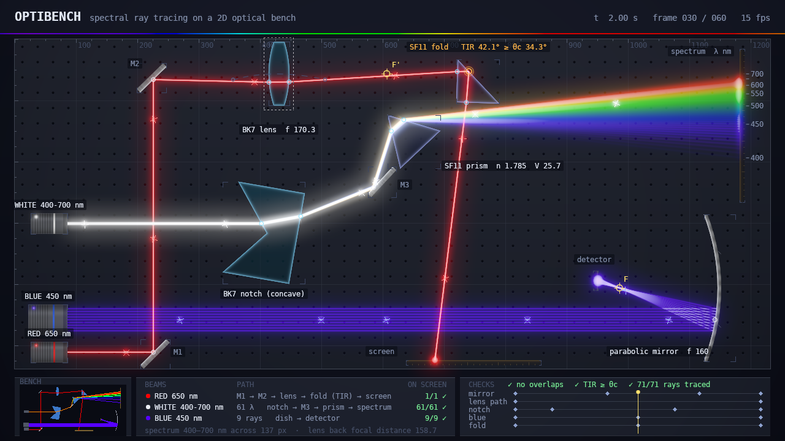
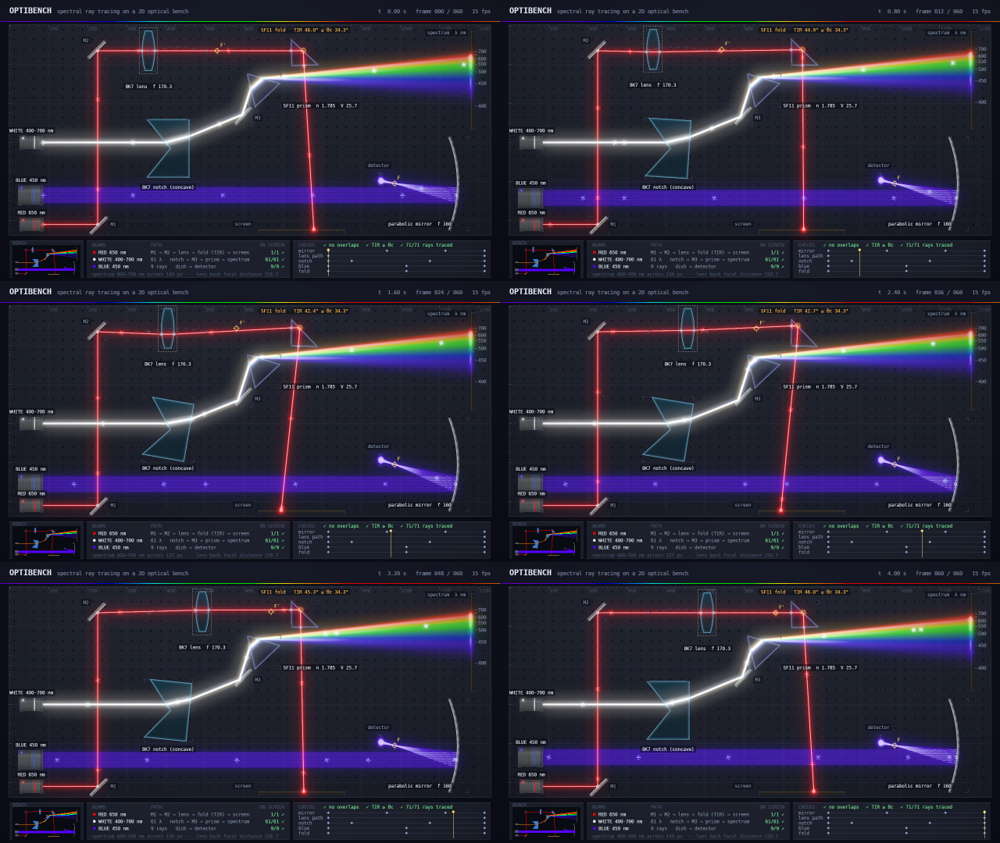

# Final combined scene

Program: `main.cpp` + `app/` (CMake target `OptiBench`) · Tests: `tests/test_app_bench.cpp`,
`tests/test_integration.cpp`, `tests/test_polygon_methods.cpp`, and the `app_smoke` run in ctest



*The bench at t = 2 s.*
- **Red:** a periscope (M1, M2), then a thick BK7 lens with its live focal length and back focus F′, then an
  SF11 fold prism that turns the beam by total internal reflection. Its label compares the angle with the
  critical angle.
- **White:** a concave notched block, then mirror M3, then an equilateral SF11 prism that splits the beam
  into a spectrum. Wavelengths are marked where they land.
- **Blue:** a 36 px collimated beam (9 rays) meets at the focus F of a parabolic mirror and lands on a detector.

*Markers: cyan rings are refractions, white rings are reflections, and the amber double ring is total
internal reflection. Corner brackets are the broad-phase bounding boxes, and the dotted XOR box selects the
moving lens. The HUD shows a minimap, each beam's path and landing count, the checks, and the keyframe timeline.*



*Six frames: t = 0, 0.8, 1.6, 2.4, 3.2 and 4.0 s. The lens glides along its Bézier arc, the notch turns with
an overshooting ease (the spectrum shifts but stays whole), the fold prism rocks (the red spot sweeps the
screen), and the blue beam slides while staying focused.*

---

## 1. Running

```bash
cmake --preset release && cmake --build --preset release
./build/OptiBench                    # Windows: .\build\OptiBench.exe (from the repository root)
./build/OptiBench --help             # options: --out, --duration, --fps, --still, --no-frames, --quiet ...
python3 tools/make_gif.py            # optional: frames -> docs/images/final_scene.gif (needs Pillow)
```

Each frame is checked: no two elements overlap, every total internal reflection is at or past the critical
angle *for that ray's wavelength*, and every ray lands on a screen. The exit status is 0 only if every check
passed and every image was written. A full run prints:

```
OptiBench 1.0.0: 61 frames (4 s at 15 fps)
  overlapping element pairs over all frames: 0
  total internal reflections: 61 (all at or past the critical angle: yes)
  rays traced: 4331, landing on a screen: 4331
  spectrum (400-700 nm) spread on the screen: at least 136 px
```

A full run takes about 8 s for 61 frames at 1280×720, single-threaded, in a Release build.

## 2. Where each module is used

| Module | Used for |
|---|---|
| Scene architecture | `Scene`, every element, `traceBeam` (now per wavelength), `Animator::setRenderer` hands drawing to the Studio |
| Lines, polygons, clipping, circles | Wu lines (foci, ticks, hatching), Cohen-Sutherland clipping of every beam to the bench, scanline fills in the minimap, midpoint circles in the sprites |
| Geometry | `ThickLensElement` (`geom::Lens`), the concave notch (`geom::rayPolygon`), `backFocus()`, the broad-phase `bounds()`, the overlap check each frame, and **anti-aliased shading** of every element from `geom::signedDistance` |
| Curves | the parabolic mirror (an exact quadratic Bézier, flattened for its highlight and hatching) and the lens's motion path |
| Transform & optics math | `Transform2D` on every element, `criticalAngle` per wavelength for every TIR, the `Mat3` (T · S · T) minimap |
| Animation | the `Animator` loop with a delta-time `Clock`, keyframe `Track` and `Vec2Track` with easing, a Bézier `MotionPath` timed by `CubicBezierEasing`, double buffering. The HUD timeline draws each track's keyframes. |
| Raster ops & sprites | photon `SpriteSheet`s colour-keyed onto the beams, the XOR-blitted selection box, the minimap `blit`ted into place, alpha-blended labels and panels |
| Rendering (new) | spectral colour, dispersion, the HDR light buffer with bloom and tone mapping, text. See [rendering.md](rendering.md). |

## 3. The application's structure

| File | Responsibility |
|---|---|
| `app/Bench.*` | the layout (720p: header, bench, HUD), the elements, the light sources (`SourceSpec`: laser, white light, collimated) and the animation |
| `app/Trace.*` | expands each source into rays (61 wavelengths, 9 parallel rays …) and traces each at its own wavelength |
| `app/Studio.*` | the renderer: backdrop, shaded elements, light, composite, overlays, HUD; returns a `FrameReport` with the checks |
| `app/Options.*` | the command-line interface |
| `main.cpp` | wires them to the `Animator`, writes the images, prints the summary and sets the exit status |

The bench is separate from the renderer, so `test_app_bench` can step the real animation with a no-op
renderer and check every frame quickly.

## 4. Changes to shared code

All of these changes are additive. Every demo's image and console output was compared byte for byte with
`master` (animation, circle/ellipse, clip/fill, curves, geometry, integrated, line, polygon, raster/sprites),
and all are identical.

* **`Material`**:
  - gains `abbeNumber` (0 = no dispersion) and `indexAt(nm)`
  - gains catalogue presets: `crownBK7`, `flintF2`, `denseFlintSF11`, `denseFlintSF66`
  - gains `glass(n, abbe)`
* **`traceBeam`** takes an optional `wavelengthNm`, which defaults to the design wavelength, where nothing changes.
* **`Animator::setRenderer`** replaces the default `scene.render(back)`; an empty function restores it.
* **`Scene::findAs`** has a `const` overload.
* **`FlatElement`** gains `halfLength()` and `thickness()`; **`LaserSource`** gains `bodyLength()` and `bodyWidth()`.
* From the integration step (unchanged since):
  - `OpticalElement::bounds/contains/outline`
  - concave `PrismElement` support
  - `ThickLensElement` and `CurvedMirrorElement`
  - the broad phase in `Scene::nearestHit`
  - `Scene::solidAt` and `overlappingPairs`
  - the previously undefined `Polygon` methods
* **CMake**:
  - the render module and the `optibench_app` library
  - the new tests, and the `app_smoke` ctest entry, which runs the application end to end
  - a `VERSION` (1.0.0, printed by `--version`)
  - `CMakePresets.json`, and CI in `.github/workflows/ci.yml`

## 5. Notes and limitations

* The tracer still models one glass body at a time. Overlapping glass would need nested media.
  `overlappingPairs()` makes that checkable, and the application checks it every frame.
* There is no Fresnel split: at each glass surface a ray either refracts or totally internally reflects,
  never both.
* `Polygon.h` and `clip_fill.h` both still define `ob::Polygon`, so they cannot share a file. The geometry
  module accepts both. Merging the two types is left to the owners of those modules.
