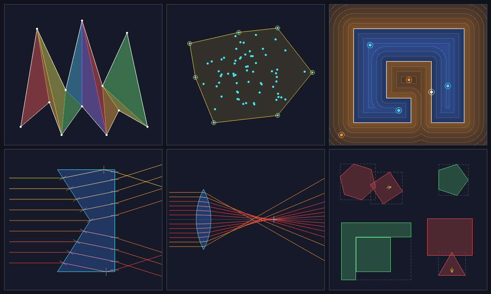

# Geometry module: shape queries for the optical bench

Owner: Cyprian Kamau · Namespace: `ob::geom` · Headers: `include/optibench/geometry/` ·
Sources: `src/geometry/` · Tests: `tests/geometry/` · Demo: `demos/geometry_demo.cpp`



*`demo_geometry` output. Top: ear-clipping triangulation of a concave polygon; the convex hull of
a point cloud; the signed distance field and point location of a concave polygon. Bottom: laser
rays refracting through a concave prism; parallel rays through a thick biconvex lens, with the
lensmaker back focus marked; overlap tests with minimum translation vectors and bounding boxes.*

---

## 1. Design

The earlier modules draw shapes. This one answers questions about them: *is this point inside?*,
*where does this ray cross the outline, and which way does the surface face?*, *do these two
elements overlap?*, *what is the hull, the centroid, the triangulation?* The scene, elements and
tracer need exactly these answers. Before this module they worked around them. Prisms had to be
convex, and the tracer had to assume beams start outside glass and that glass never overlaps.

```
  Primitives.h ──► PolygonOps.h ──► Intersect.h ──► Overlap.h
  orientation       area, centroid     ray vs box      SAT + minimum translation vector
  segment ∩ seg     winding, simple    ray vs polygon  concave overlap (triangulate + SAT)
  closest point     convex, locate     convex spans ─┐ disc overlap
  Aabb (reused)     normals, hull                    │
                    triangulation                    └──► Lens.h  thick lens = ∩ of convex pieces
```

* **One polygon signature for both polygon types.** Every function takes
  `std::span<const Vec2>`. The `clip_fill.h` polygon (`std::vector<Vec2>`) passes straight in, and
  `Polygon.h`'s struct passes its `.vertices`. Neither type had to change, and the module includes
  neither header, so it can be used next to either.
* **Either winding order.** Functions that need an orientation read it from the sign of the
  area. A clockwise outline, or one mirrored by a negative scale, gives the same normals and
  answers.
* **Normals follow the solid-element convention** of `OpticalElement.h`: they always point out
  of the shape. The caller compares with the ray direction to know whether the ray is entering.
* **One tolerance policy** (`Primitives.h`). `kEps = 1e-9` is an absolute length in scene units,
  for "same point" and "on the edge". `kRelEps = 1e-12` is a relative tolerance for cross
  products: three points are collinear when the sine of their angle is below it. Because it is
  relative, a 1-pixel triangle and a 10⁶-pixel triangle get the same answer.
* **Exact where it matters.** Segment intersection classifies with orientation tests before
  dividing. Shared endpoints, T-junctions and collinear overlaps are therefore reported exactly,
  never lost to rounding. Areas and centroids are computed relative to the first vertex, which
  keeps full precision far from the origin.
* **Reuse, don't duplicate.** The module uses the curves module's `Aabb` and `boundsOf`, `Line.h`'s
  `Segment` and `distanceToSegment`, and `Transform2D` for local and world transforms. The tests
  cross-check against `rayCircleIntersect` (circles) and trace rays with `refract` (optics).
* **No drawing.** The module returns numbers and polygons. The demo draws them with the existing
  line, fill and blend code.

### Files

| Header | Contents |
|---|---|
| `Primitives.h` | tolerances, `orientation`, `cross`, `projectParam`, `closestPointOnSegment`, `onSegment`, `intersect(Segment, Segment)` (none / point / overlap), `properlyCross`, `Aabb` + `boundsOf`, `inflate`, `overlaps` |
| `PolygonOps.h` | `signedArea`, `area`, `perimeter`, `centroid`, `winding`, `toCounterClockwise`, `cleaned`, `isSimple`, `isConvex`, `locate` / `contains` / `windingNumber`, `distanceToBoundary`, `signedDistance`, `edge`, `outwardNormal`, `nearestEdge`, `convexHull`, `triangulate`, `regularPolygon`, `rectangle`, `transformed` |
| `Intersect.h` | `rayAabb` (slab), `rayPolygonAll` / `rayPolygon` (concave, vertex-exact), `LineSpan` CSG: `lineDisc`, `lineHalfPlane`, `intersectSpans`, `firstHit` |
| `Overlap.h` | `separateConvex` (SAT + minimum translation vector), `separateConvexCircle`, `separateCircles`, `polygonsOverlap` (any simple polygons), `polygonCircleOverlap` |
| `Lens.h` | `Lens`: biconvex, plano-convex, edged or slab lens; `contains`, `intersect`, `outline`, `bounds`, `focalLength`, `backFocalDistance`, `frontFocalDistance` |
| `Geometry.h` | umbrella header |

---

## 2. Usage

```cpp
#include "optibench/geometry/Geometry.h"
using namespace ob;
using namespace ob::geom;

std::vector<Vec2> prism = {{0, 0}, {120, 0}, {120, 200}, {0, 200}, {70, 100}};   // concave

area(prism);                      // 17000 (the 120 x 200 block minus a 7000 notch)
centroid(prism);                  // (75.1, 100): centre of mass, pushed right by the notch
isSimple(prism);  isConvex(prism); // true, false
locate(prism, {20, 100});         // PointLocation::Outside (in the notch)
outwardNormal(prism, 3);          // (-0.819, -0.573): the notch face points into the notch
```

### Rays

```cpp
const Ray ray{{-50, 40}, {1, 0}};
const Hit h = rayPolygon(ray, prism);                     // nearest crossing, outward normal
const bool entering = ray.direction.dot(h.normal) < 0.0;

for (const PolygonHit& c : rayPolygonAll(ray, prism)) { /* every crossing, nearest first */ }

if (auto box = rayAabb(ray, boundsOf(prism))) { /* box->tNear, box->tFar: cheap broad phase */ }
```

`rayPolygon` is a drop-in for the `Hit` that elements return. It works for concave outlines,
which `PrismElement`'s centroid trick does not, and also from inside the shape.

### Overlap

```cpp
const Separation s = separateConvex(a, b);   // convex polygons
if (s.overlapping) moveB(s.normal * s.depth); // the minimum translation vector

polygonsOverlap(lShape, block);              // any simple polygons; touching is not overlapping
polygonCircleOverlap(poly, centre, radius);
```

### Thick lens

```cpp
const Lens lens(160.0, 160.0, 36.0);         // R1, R2 (kFlat for a flat face), centre thickness[, aperture]
lens.halfHeight();                           // 73.73: where the faces meet
lens.focalLength(1.5);                       // 166.23  (thick-lens lensmaker equation)
lens.backFocalDistance(1.5);                 // 153.77  from the back vertex

// in the lens's own frame (optical axis = x, centred on the origin):
const Hit in = lens.intersect(Ray{{-200, 10}, {1, 0}});   // exact entry point + outward normal
std::vector<Vec2> outline = lens.outline(64);             // for drawing / polygon queries
```

`Lens` takes a local frame, like `LensElement`'s circle. To place it, carry the ray in with
`Transform2D::toLocal` and `dirToLocal`, and carry the hit back out with `toWorld` and
`normalToWorld`.

---

## 3. The math, briefly

**Orientation.** cross(a, b, c) = (b − a) × (c − a) is twice the signed area of the triangle: positive
for a left (counter-clockwise) turn. Comparing |cross| with kRelEps·|b − a|·|c − a| tests the sine of the
angle, which is what makes the predicate scale-independent.

**Segment intersection.** Each segment's endpoints are classified against the other's line. Opposite
sides on both means a crossing, and only then is the point solved for. When all four tests are
collinear, both segments are projected onto one parameter line and the two intervals are intersected:
an empty interval is no hit, a single parameter is a point, and a longer one is an overlap.

**Area and centroid.** The shoelace formula, written as a fan from vertex 0:
A = ½ Σ (pᵢ − p₀) × (pᵢ₊₁ − p₀). The centroid is the area-weighted mean of the fan triangles'
centroids. Zero-area input falls back to the length-weighted centre of the edges.

**Point location.** The winding number, by Sunday's crossing rule: an upward edge with the point
strictly to its left adds 1, and a downward edge with the point strictly to its right subtracts 1.
It uses no trigonometry and has no special cases for vertices or horizontal edges. A point within
`tol` of an edge is reported as `Boundary` before the winding number is consulted.

**Outward normals.** For a counter-clockwise outline the interior is on the left of every edge, so the
outward normal of edge d is the right-hand normal (d.y, −d.x). The sign of the area flips it for
clockwise outlines. This holds for concave polygons, where pointing away from the centroid does not.

**Convexity.** Every turn must have the same sign, and the turning angles must add up to ±2π. The
second condition rejects the pentagram, which turns the same way at every vertex but winds round twice.

**Convex hull.** Andrew's monotone chain. Sort the points, then build the lower and upper chains,
popping any point that does not make a strict left turn. That takes O(n log n). Duplicates and
collinear points are dropped.

**Triangulation.** Ear clipping. Straight-through vertices are removed first. A vertex is an ear if it
turns left and no other remaining vertex lies inside or on its triangle. Each clipped ear removes one
vertex, so n vertices give n − 2 triangles that exactly tile the polygon.

**Ray vs polygon.** For edge a→b with q = b − a, the ray o + t·d meets it where
t = (a − o) × q / (d × q) and u = (a − o) × d / (d × q), with 0 ≤ u ≤ 1. A crossing at a vertex is
found by both of its edges. It counts once if the two neighbouring vertices lie on opposite sides of
the ray (a real crossing, normals averaged), and not at all if they lie on the same side (a graze).

**Ray vs box.** The slab method: intersect the ray's t-intervals between each pair of parallel faces.
A ray parallel to a pair of faces is handled explicitly, so it never computes 0·∞.

**SAT.** Two convex shapes are disjoint if and only if their projections onto some edge normal do not
overlap. The axis with the least overlap gives the minimum translation vector. When one projection
contains the other, the shape has to be pushed past the nearer end as well, which is added to the depth.
Disc tests add one more axis, from the centre to the nearest vertex. Concave polygons are triangulated
and their triangle pairs tested, after a bounding-box reject.

**Lens as a convex intersection (CSG).** Each face is a convex piece: a disc (curved face) or a
half-plane (flat face or aperture cut). Along a line each piece is one interval [tᵢₙ, tₒᵤₜ], and the lens
is where they all overlap: tᵢₙ = max, tₒᵤₜ = min. The first boundary at t ≥ tMin is the hit, and the
piece that set it supplies the normal. The rim height comes from the radical line of the two face
circles, x = (c₁ + c₂)/2 + (R₁² − R₂²)/(2(c₂ − c₁)). The disc roots use the stable form t = −h − sign(h)·√Δ
and t' = k/t, so a lens far from the origin loses no digits.

**Thick lens in air** (radii positive for convex faces, 1/R = 0 for a flat face):
1/f = (n − 1)[1/R₁ + 1/R₂ − (n − 1)d/(n R₁ R₂)], back focal distance BFD = f(1 − (n − 1)d/(n R₁)).
The lens tests do more than compare formulas. They trace paraxial rays through the lens with
`refract` (optics) and check that they cross the axis within 0.02 px of the predicted focus.

### Complexity

n, m = vertex counts.

| Operation | Cost |
|---|---|
| `orientation`, `intersect(Segment, Segment)` | O(1) |
| `signedArea`, `centroid`, `perimeter`, `locate`, `signedDistance` | O(n) |
| `isConvex` | O(n) (plus `cleaned`, O(n) per sweep) |
| `isSimple` | O(n²) pairwise edge tests: fine for bench-sized shapes |
| `convexHull` | O(n log n) |
| `triangulate` | O(n²) worst case (ear test against remaining vertices), plus `isSimple` |
| `rayAabb` / `rayPolygonAll` | O(1) / O(n log n) (O(n) edges + sort of the crossings) |
| `separateConvex` | O((n + m)²): n + m axes × n + m projections (after an O(n log n) hull) |
| `polygonsOverlap` | O(n² + m²) to triangulate + O(n·m) triangle pairs, each with a box reject |
| `Lens::intersect` | O(1): two discs or half-planes, plus two aperture half-planes |

---

## 4. Trade-offs and limitations

* **Touching is not overlapping.** Overlap requires the interiors to share area deeper than `tol`.
  Glass blocks set flush against each other, or a block resting in an L's notch, are allowed.
* **A ray running exactly along an edge** reports the two corners where it meets the neighbouring
  edges. Physically, it grazes a flat face.
* **`triangulate` and `polygonsOverlap` need simple polygons.** `triangulate` returns nothing for a
  self-intersecting outline. `polygonsOverlap` then falls back to edge crossings and containment.
* **`isSimple` is O(n²).** Bench shapes have tens of vertices, so this is cheap. A sweep line would only pay
  off for thousands.
* **Lens faces are convex.** Biconvex, plano-convex, edged and slab lenses are supported. A concave
  (diverging) face is not a convex piece and would need a different construction. Each curved face is
  at most a hemisphere, as on every real lens, which keeps the rim the widest part.
* **Coordinates are y-agnostic.** "Counter-clockwise" means in y-up maths axes. On the y-down
  framebuffer the same order looks clockwise. No result depends on which way y points.

### Notes for teammates

* **Integrated into the scene.** Prisms intersect with `rayPolygon`, so concave prisms work. Elements
  report `bounds()`, `contains()` and `outline()`. `Scene::nearestHit` rejects elements by box,
  `traceBeam` knows when a beam starts inside glass, and `Scene::overlappingPairs()` finds overlapping
  elements. `ThickLensElement` puts `Lens` on the bench. See [final_scene.md](final_scene.md).
* `Polygon.h`'s `contains_point` and `centroid` (previously declared but never defined) are now
  implemented with `geom::contains` and `geom::centroid`.

---

## 5. References

1. J. O'Rourke, *Computational Geometry in C*, 2nd ed., Cambridge University Press, 1998. (orientation, segment intersection, ear-clipping triangulation, convex hulls)
2. M. de Berg, O. Cheong, M. van Kreveld and M. Overmars, *Computational Geometry: Algorithms and Applications*, 3rd ed., Springer, 2008.
3. A. M. Andrew, "Another efficient algorithm for convex hulls in two dimensions," *Information Processing Letters* 9(5), 1979.
4. D. Sunday, "Inclusion of a point in a polygon," geomalgorithms.com, 2001. (the winding-number crossing rule)
5. D. H. Eberly, *3D Game Engine Design*, 2nd ed., Morgan Kaufmann, 2006. (the separating axis theorem)
6. C. Ericson, *Real-Time Collision Detection*, Morgan Kaufmann, 2005. (slab test, SAT, robustness)
7. E. Hecht, *Optics*, 5th ed., Pearson, 2017. (§6.2: thick lenses, the lensmaker's equation and focal distances)
